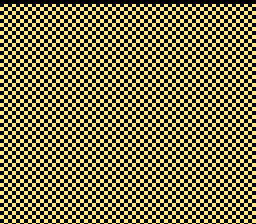
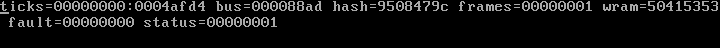

# SnesFx

SnesFx is a headless Super Nintendo emulator written in NASM x86 assembly.
One emulator core builds for 386-compatible DOS and BIOS as well as modern
x86‑64 Linux, macOS, and Windows.

The current milestone is a reproducible diagnostic runner. It boots an
original test cartridge, exercises 65C816 arithmetic and DMA during a
scheduled interrupt, and renders a 256 × 224 frame. Linux and macOS can
export the frame and a timestamped guest bus trace.

| Diagnostic frame | 386-compatible BIOS diagnostic |
| --- | --- |
|  |  |
| Native PPU output from the bundled diagnostic cartridge. | QEMU with its 486 CPU model and 2 MiB RAM. `wram=50415353` spells `PASS`. |

## Quick start

Build with NASM 2.16 or later and Make. The test harness also uses Python 3.
Running the relevant target requires an x86‑64 host, Rosetta on Apple Silicon,
or a suitable virtual machine.

```sh
make all
```

`make all` assembles the five host targets and the original diagnostic
cartridge. `make linux`, `make macos`, `make windows`, `make dos`, and
`make boot386` build individual targets. If you build just a host, run
`make build/diagnostic.sfc` to assemble the sample cartridge.

### Linux and macOS

```sh
build/snes-linux build/diagnostic.sfc 200000 build/frame.ppm build/trace.bin
```

On Apple Silicon, run the x86‑64 macOS binary with Rosetta. On Intel Macs, run
it directly.

```sh
arch -x86_64 build/snes-macos build/diagnostic.sfc 200000 build/frame.ppm build/trace.bin
```

The first argument is the ROM. The second is an optional instruction budget
that defaults to 10,000,000. The third is an optional PPM output path. The
fourth saves a binary trace. Use `-` in the frame slot to export a trace by
itself.

### Windows x64

```powershell
.\build\snes-win.exe .\build\diagnostic.sfc 200000 .\build\frame.ppm
```

The Windows runner accepts the ROM, an optional instruction budget, and a
PPM output path. Its PE headers and imports have been checked. Runtime
verification is pending.

### DOS and 386 BIOS

On DOS, use a 32-bit DPMI host. With CWSDPMI, put the DPMI executable, the
SnesFx executable, and the diagnostic cartridge in the DOS working directory.
The example names the cartridge `DIAG.SFC`.

```text
CWSDPMI -p
SNESDOS DIAG.SFC 200000
```

The BIOS image embeds the cartridge and reports directly to VGA text. Boot it
with a floppy-capable PC BIOS and at least 2 MiB RAM, or use QEMU.

```sh
qemu-system-i386 -cpu 486 -m 2M \
  -drive file=build/snes-386.img,format=raw,if=floppy,readonly=on -boot a
```

Use `make boot386 ROM=path/to/cart.sfc` to embed another supported cartridge.
The image has approximately 512 KiB for the ROM and executable combined.

## What works

| Component | Current coverage |
| --- | --- |
| CPU and cartridge bus | 65C816 opcode handlers, byte-ordered accesses, slow and fast ROM timings, WRAM, open-bus behavior, DMA and HDMA, partial IRQ/NMI timing, and LoROM, HiROM, and ExHiROM mapping. SRAM lasts for the current session. |
| Video | Scanline rendering at 256 × 224, including backgrounds in modes 0, 1, 3, and 7, sprites, windows, brightness, and color math. |
| Sound CPU | Optional SPC700 build with timers, communication ports, and independent clock accumulation. The test suite assembles an original diagnostic IPL. S-DSP audio output is pending. |
| Host tools | Headless diagnostics on all targets. Linux and macOS export PPM frames and binary bus traces. Windows supports PPM export. |

Live input and presentation, dot-accurate rendering, save states, enhancement
chips, and complete hardware timing are in the [roadmap](ROADMAP.md).
Original console conformance and real-time performance on physical 386 and
486 systems are still unverified.

To test the SPC700 path with an original fixture, run `make test-apu`. For a
64-byte S-SMP IPL you provide, build in a separate output directory.

```sh
make OUT=build/with-ipl IPL=path/to/ipl.bin linux
```

## Read the diagnostic result

A successful run of the bundled cartridge produces this summary.

```text
ticks=00000000:0004afd4 bus=000088ad hash=9508479c frames=00000001 wram=50415353 fault=00000000 status=00000001
```

`ticks` is the 64-bit guest clock in hexadecimal. `bus` counts recorded guest
bus events and `hash` summarizes their order and contents. `wram` prints the
four bytes at WRAM offset `$1FF0`. A process exit of 0 means the guest
executed `STP`. Check `wram=50415353` for the diagnostic's own verdict.

On Linux and macOS, process exit 2 indicates a ROM or command-line error,
3 a CPU fault, 4 an exhausted instruction budget, and 5 an output error.
The binary trace stores up to the first 65,536 events as little-endian
`<QII` records: master tick, tagged guest address, and byte value. Address
tags 0, 1, 2, and 3 indicate CPU read, CPU write, DMA read, and DMA write.
The summary count and hash also cover events past the export limit.

## Development

```sh
make test
make test-apu
make test-boot
```

`make test-boot` uses QEMU and compares the 386-compatible boot summary
against the native-format runner. The
[testing guide](docs/TESTING.md) describes the fixtures and verified
environments. The [architecture guide](docs/ARCHITECTURE.md) maps subsystem
behavior to the assembly files. See [Contributing](CONTRIBUTING.md) for
reproductions and pull requests.
